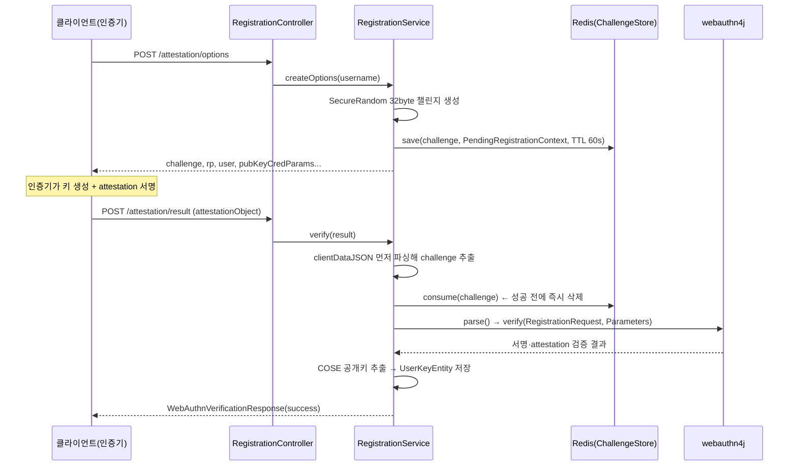
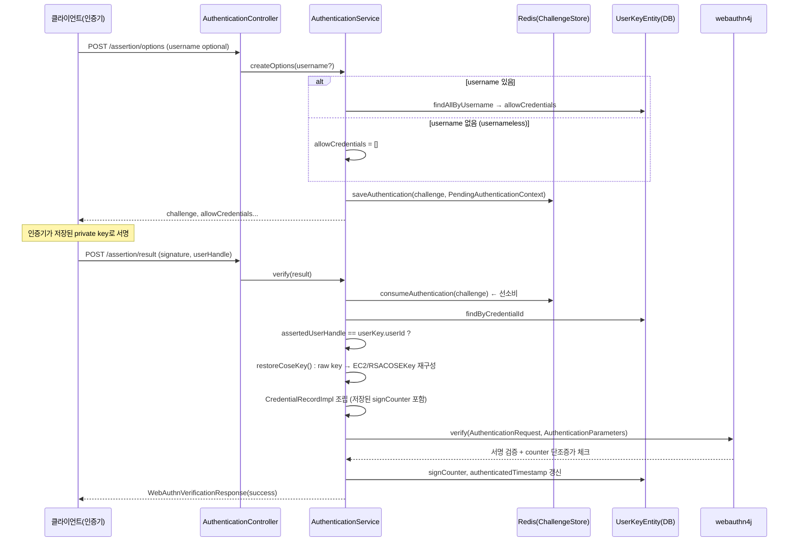

# FIDO2 WebAuthn 데모 서버 — 인증·검증 흐름

Kotlin + Spring Boot · webauthn4j 0.31.10 · `com.raonsecure.demoserver`

## 목차

1. [전체 구조](#전체-구조)
2. [핵심 엔티티](#핵심-엔티티)
3. [등록(Registration) 흐름](#registration-등록-흐름)
4. [인증(Authentication) 흐름](#authentication-인증-흐름)
5. [설계 포인트 정리](#설계-포인트-정리)

---

## 전체 구조

등록(attestation)과 인증(assertion), 두 개의 세레모니를 **webauthn4j** 라이브러리에 맡기고, 서버 코드는 챌린지 관리·정책 고정·DB 영속화를 담당하는 구조다.

| 패키지 | 역할 |
|---|---|
| `registration/` | 등록 컨트롤러·서비스·챌린지 저장소 |
| `authentication/` | 인증 컨트롤러·서비스·챌린지 컨텍스트 |
| `base/entity, repository` | RP·Credential·Transport JPA 엔티티 |
| `config/` | WebAuthnManager 빈, RP 속성, 임베디드 Redis |
| `common/data` | 요청/응답 DTO |

저장소: credential은 **H2**(인메모리), 챌린지는 **Redis**(임베디드)에 60초 TTL로 저장된다.

## 핵심 엔티티

**`RpEntity`** — Relying Party 식별자. `id`(rpId, 예: `"localhost"`), `name`. `WebAuthnRpProperties`에서 읽어 부팅 시 `RpSeeder`가 심어둔다.

**`UserKeyEntity`** — 등록된 credential 1건. `credentialId`, `publicKey`(X.509 raw bytes, base64 TEXT), `signatureAlgorithm`(COSE alg: `-7`=ES256, `-257`=RS256), `signCounter`, `aaguid`, `attestationType`. `RpEntity`에 `@ManyToOne`.

**`AuthenticatorTransportEntity`** — usb / nfc / ble / internal 등 전송 수단 힌트. `UserKeyEntity`에 `@ManyToOne(cascade = ALL)`로 종속.

---

## registration 등록 흐름

`POST /attestation/options` → `POST /attestation/result`



### 1단계 — 챌린지 발급

`RegistrationService.createOptions()`가 32바이트 랜덤 챌린지를 만들고, **사용자별 user handle을 재사용**(같은 username이면 같은 handle)하면서, 이번 등록에 적용할 `userVerification` 정책을 함께 Redis에 저장한다.

> **핵심 설계:** 검증 정책(userVerification 요구 여부)을 이 시점에 서버가 고정해서 저장한다. 나중에 `/attestation/result` 호출 시 클라이언트가 뭘 보내든 이 저장된 값으로만 검증하므로, 클라이언트가 검증 수준을 낮춰서 보낼 수 없다.

`registration/challenge/ChallengeStore.kt`
```kotlin
interface ChallengeStore {
    fun save(challenge: String, context: PendingRegistrationContext, ttl: Duration)
    fun consume(challenge: String): PendingRegistrationContext?
    fun saveAuthentication(challenge: String, context: PendingAuthenticationContext, ttl: Duration)
    fun consumeAuthentication(challenge: String): PendingAuthenticationContext?
}
```

`RedisChallengeStore`는 `consume`을 **get-and-delete**로 구현한다 — 조회와 삭제가 원자적이라 같은 챌린지를 두 번 쓸 수 없다(재사용/리플레이 방지).

### 2단계 — 검증(`verify`)

1. `credentialId` 중복 등록 거부
2. **clientDataJSON을 attestationObject보다 먼저 디코딩**해 챌린지만 뽑아내고, 즉시 `challengeStore.consume()`으로 소비
3. `webAuthnManager.parse()`로 포맷 에러 선별
4. `ServerProperty` 구성 — 챌린지는 **저장된 값**을 쓴다(클라이언트가 주장하는 값이 아님)
5. `webAuthnManager.verify(RegistrationRequest, RegistrationParameters(..., userVerificationRequired, true))` 호출 — **여기서 attestation 서명이 실제로 검증**됨. `userVerificationRequired`는 1단계에 저장해둔 정책값
6. 검증 통과한 `AttestedCredentialData.coseKey`에서 공개키 raw bytes·COSE alg·aaguid 추출 → `UserKeyEntity` 저장

> **왜 챌린지를 먼저 소비하는가.** 코드 주석의 설명: "파싱이 실패해도 챌린지는 반드시 타버려야 한다" — 그래야 공격자가 실패하는 요청을 반복 전송해 같은 챌린지로 재시도(replay)하는 걸 막을 수 있다.

`registration/RegistrationService.kt` — attestation 타입 분류
```kotlin
is NoneAttestationStatement -> AttestationType.NONE
is AppleAnonymousAttestationStatement -> AttestationType.ANON_CA
is CertificateBaseAttestationStatement ->
    if (statement.x5c == null) AttestationType.SELF else AttestationType.BASIC
else -> AttestationType.BASIC
```

---

## authentication 인증 흐름

`POST /assertion/options` → `POST /assertion/result`



### 1단계 — 챌린지 발급 (usernameless 지원)

username이 있으면 해당 사용자의 credential 목록을 `allowCredentials`로 내려준다(없으면 404). username이 없으면 `allowCredentials`를 빈 리스트로 둬서 **discoverable(usernameless) 로그인**을 허용한다.

`PendingAuthenticationContext`에 `usernameProvided` 플래그를 따로 둔다 — "지정된 사용자인데 credential이 0개"와 "진짜 usernameless 로그인"을 구분하기 위함.

### 2단계 — 검증. 등록과 다른 점: webauthn4j가 안 해주는 걸 서버가 수동으로 메꾼다

**(a) 챌린지 선소비.** 등록과 동일한 패턴. clientDataJSON을 먼저 파싱해 챌린지를 꺼내고 즉시 `consumeAuthentication`으로 삭제한다.

**(b) COSE 키 재구성 — DB엔 raw bytes만 있다.** 등록 시 저장한 건 X.509 raw 공개키 bytes뿐, COSE 형식이 아니다. 그래서 인증 때마다 `signatureAlgorithm` 값을 보고 직접 재구성해야 한다.

`authentication/AuthenticationService.kt` — COSE 키 재구성
```kotlin
-7 -> {
    val pubKey = kf.generatePublic(X509EncodedKeySpec(keyBytes)) as ECPublicKey
    EC2COSEKey.create(pubKey, COSEAlgorithmIdentifier.create(-7L))
}
-257 -> {
    val pubKey = kf.generatePublic(X509EncodedKeySpec(keyBytes)) as RSAPublicKey
    RSACOSEKey.create(pubKey, COSEAlgorithmIdentifier.create(-257L))
}
```

이 COSE 키 + `aaguid` + `credentialId` + 저장된 `signCounter`를 묶어 `CredentialRecordImpl`을 만든다 — webauthn4j에게 "지금 DB가 믿고 있는 credential 상태"를 알려주는 방법이다.

**(c) 사용자 핸들 바인딩 — 전부 수동 코드.** webauthn4j의 `CredentialRecordImpl`은 사용자 신원을 들고 있지 않다. 그래서 서버가 직접 비교한다:

```kotlin
assertedUserHandle == userKey.userId
// 불일치 시 UserHandleMismatchException
```

usernameless 로그인은 userHandle이 반드시 와야 하며, 없으면 거부된다.

**(d) 실제 서명 검증 — webauthn4j 호출 한 줄.**

```kotlin
webAuthnManager.verify(authRequest, authParameters)
// AuthenticationParameters(serverProperty, credentialRecord, null, userVerificationRequired, true)
```

여기서 `authenticatorData || SHA256(clientDataJSON)`에 대한 서명을 재구성된 COSE 공개키로 검증하고, origin·rpIdHash·challenge·flags·signCounter 단조증가까지 전부 체크한다.

> **서명 카운터 역행 = 클론 의심.** webauthn4j가 `MaliciousCounterValueException`을 던지면(카운터가 증가하지 않음) 서버는 이를 `SignCounterRegressionException(storedCounter, presentedCounter)`로 변환해서 다시 던진다.

---

## 설계 포인트 정리

| 포인트 | 구현 위치 |
|---|---|
| 챌린지 1회성 소비 (replay 방지) | Redis `getAndDelete` |
| 검증 정책을 options 시점에 서버가 고정 | `PendingRegistrationContext.userVerification` |
| 파싱 실패해도 챌린지는 소비됨 | clientDataJSON 선파싱 → consume → 그 다음 attestation 파싱 |
| COSE 키는 등록 시엔 webauthn4j가 주지만, 인증 시엔 수동 재구성 | `AuthenticationService.restoreCoseKey()` |
| 사용자 핸들 바인딩은 webauthn4j 밖에서 수동 체크 | `AuthenticationService.verify()` |
| 카운터 역행 감지 → 클론 의심 예외로 변환 | `MaliciousCounterValueException → SignCounterRegressionException` |

테스트 코드 `src/test/kotlin/.../ceremony/`에 replay·counter regression·user-handle mismatch·origin mismatch 등 엣지케이스별 테스트가 있다. 더 깊이 보고 싶으면 그쪽이 가장 정확한 레퍼런스다.
