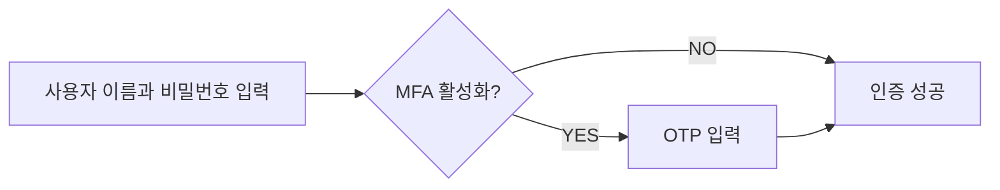

# WebAuthn

WebAuthn(Web Authentication API)는  W3C와 FIDO Alliance가 개발한 FIDO2 표준을 사용한 웹 인증을 위한 명세입니다.
WebAuthn은 웹사이트가 공개 키 암호화로 보호된 피싱 저항 자격 증명인 패스키를 구현할 수 있도록 API를 제공합니다.
패스키는 비밀번호 없는 로그인과 [다요소 인증](./multi-factor-authentication.md) 모두에 대해 비밀번호를 대체할 수 있게 구성할 수 있습니다.

## WebAuthn Workflow

### MFA 인증 예시

위의 예시에는 크게 2가지 요소가 있습니다.

1. 사용자의 이름과 비밀번호
2. OTP

각 요소는 사용자를 인증하는데 사용할 수 있는 다른 범주의 자격증명을 나타냅니다. 실제로 요소들은 주로 3가지 유형으로 구분할 수 있습니다.

|      | 의미            | 검증요소                                                        |
| ---- | --------------- | --------------------------------------------------------------- |
| 지식 | 당신이 아는 것  | 비밀번호, 이메일 인증 코드, 백업 코드                           |
| 소유 | 당신이 가진 것  | SMS 인증 코드, 인증 앱 OTP, 하드웨어 OTP (보안 키), 스마트 카드 |
| 내재 | 당신이 누구인가 | 지문, 얼굴 인식 등 생체 인증                                    |

일반적인 MFA 설정은 예시와 같이 다른 범주에서 두 가지 이상의 요소를 결합하는 것을 말합니다.

## MFA가 중요한 이유

>[!info] 완벽한 보안이라는 것은 없으며, 단지 다양한 수준의 불안정성만 있을 뿐이다. —Salman Rushdie

MFA의 중요성은 수치에서 명백합니다: MFA는 전체 인구에서 99.22%, 유출된 자격 증명의 경우 98.56%로 타협의 위험을 줄입니다.

MFA의 도움으로 민감한 데이터에 접근하고 금융 거래를 수행하는 것과 같은 더 중요한 작업을 자신 있게 수행할 수 있습니다.

이는 비밀번호나 단일 요소 인증보다 훨씬 높은 보안 수준을 제공하는 간단하면서도 효과적인 방법입니다.

## 현대 애플리케이션에서의 MFA

MFA는 두 개 이상의 요소를 포함할 수 있지만, 요소의 수가 증가함에 따라서 보안 수준과 인증 프로세스의 복잡성이 증가하여 사용자 친화적이지 않게 될 수 있습니다.

현대의 애플리케이션은 [WebAuthn](./webauthn.md) API를 사용하여 공개 키 암호화로 보호된 피싱 방지 자격 증명인 패스키를 사용한 MFA를 구현할 수 있습니다.

## 보안 고려 사항

MFA를 구현할 때 몇 가지 보안 고려 사항을 고려해야 합니다.

- 다른 범주의 요소를 결합하여 보다 높은 수준의 보안을 확보합니다. 예를 들어, 비밀번호(지식)와 TOTP 코드(소유)를 결합합니다.

- SIM 스와핑 공격에 취약하기 때문에 SMS를 MFA 요소로 사용하는 것을 피합니다.

- 복구 옵션은 MFA를 우회하지 않아야 합니다. 예를 들어, 사용자가 인증 앱을 잃어버린 경우, 백업 코드나 다른 MFA 요소를 사용하여 접근을 복구해야 합니다.

- brute-force 공격을 방지하기 위해 실패한 MFA 시도 사이에 쿨다운 기간을 시행합니다.