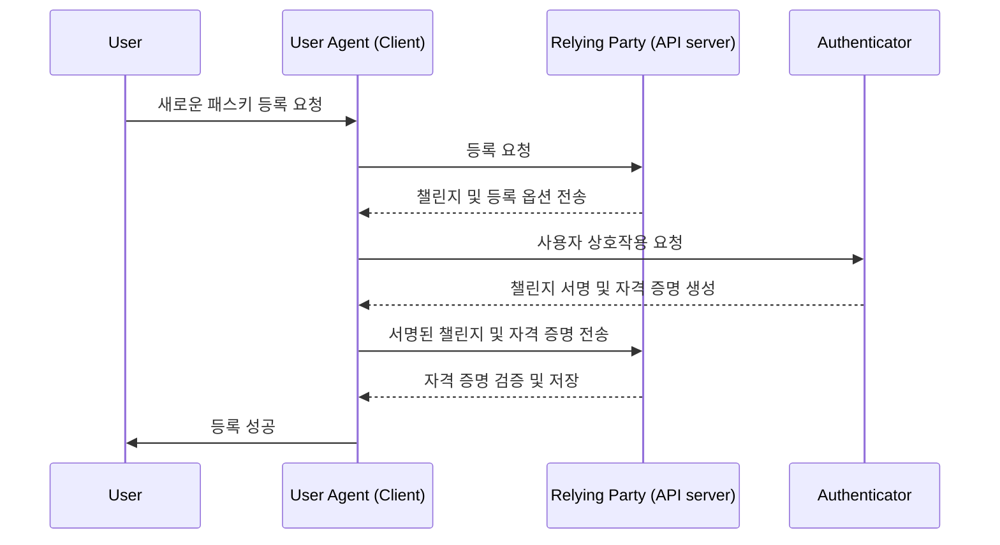
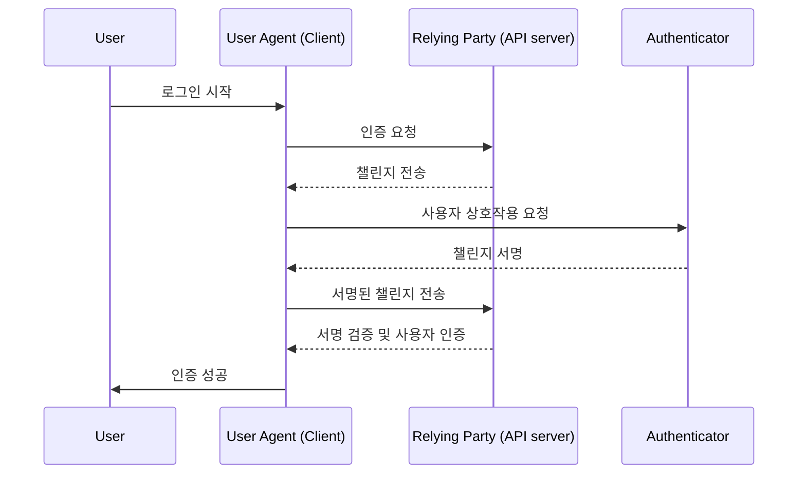

# WebAuthn

WebAuthn(Web Authentication API)는  W3C와 FIDO Alliance가 개발한 FIDO2 표준을 사용한 웹 인증을 위한 명세입니다.
WebAuthn은 웹사이트가 공개 키 암호화로 보호된 피싱 저항 자격 증명인 패스키를 구현할 수 있도록 API를 제공합니다.
패스키는 비밀번호 없는 로그인과 [다요소 인증](./multi-factor-authentication.md) 모두에 대해 비밀번호를 대체할 수 있게 구성할 수 있습니다.

## WebAuthn Workflow

### 주요 엔티티

1. 사용자 : 웹 애플리케이션에 접근하려는 개인.
2. 사용자 에이전트 : WebAuthn API 호출을 처리하고 사용자, 신뢰 당사자, 인증자 간의 인증 과정을 관리하는 웹 브라우저.
3. 신뢰 당사자 : 사용자가 **접근하려는** 서비스, 애플리케이션 또는 API 서버.
4. 인증자 : 사용자의 신원을 확인하는 데 사용되는 하드웨어 또는 소프트웨어 구성 요소. 이는 플랫폼이나 브라우저 기능에 따라 보안 키(예: Yubikeys), 전화기 또는 태블릿(블루투스, NFC 또는 USB로 연결), 장치 기반 생체 인식 또는 PIN 등 다양한 형태를 취할 수 있습니다.

### 등록 단계

비대칭 공개 키 암호화 과정

1. **키 쌍 생성** : 사용자 에이전트가 공개키 비공개 키 쌍을 생성
2. **등록 챌린지** : 사용자가 패스키를 등록할 때, 신뢰 당사자는 사용자 에이전트에 등록 챌린지 전송
3. **사용자 확인** : 사용자 에이전트는 챌린지를 인증자에게 전달하고, 인증자는 사용자에게 확인을 요청 (ex: 생체 인증 또는 하드웨어 보안 키)
4. **암호화 서명** : 자신의 비공개 키를 사용하여 챌린지를 서명하고 암호화 서명을 생성
5. **검증 및 접근** : 사용자 에이전트는 서명된 챌린지를 신뢰 당사자에게 다시 보내고, 신뢰 당사자는 공개 키를 사용하여 서명을 검증하고 등록 과정을 완료

### 인증 단계

1. **인증 챌린지:**
사용자가 로그인하려고 할 때, 신뢰 당사자는 사용자 에이전트에 인증 챌린지를 보냅니다.
2. **사용자 확인:**
사용자 에이전트는 챌린지를 인증자에게 보내고, 인증자는 사용자에게 확인을 요청합니다(예: 생체 인증 또는 하드웨어 보안 키).
3. **암호화 서명:**
인증자는 자신의 비공개 키를 사용하여 챌린지를 서명하고 암호화 서명을 생성합니다.
4. **검증 및 접근:**
사용자 에이전트는 공개 키를 사용하여 서명을 검증하고 신뢰 당사자에게 성공적인 인증을 알립니다. 검증이 성공하면 접근이 허용됩니다.

